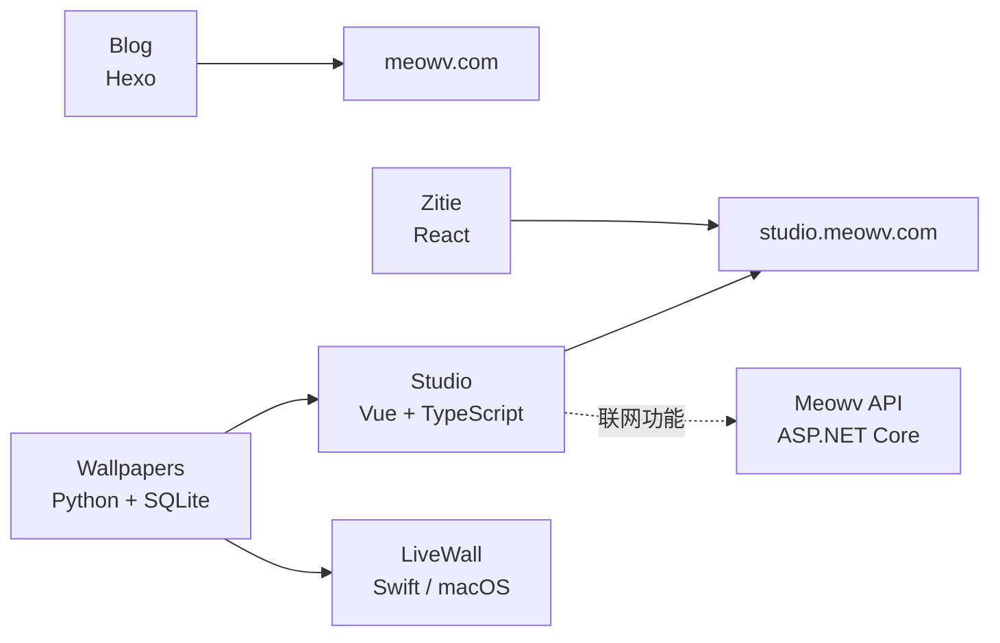

<div align="center">


<h1>Meowv</h1>
<h3>从一篇博客，到一间装满工具的工作室。</h3>
<p><strong>A little corner of the web, built with curiosity.</strong></p>
<p>
  记录技术、创造工具、折腾有趣的想法。
  <br />
  这里既有持续更新的个人博客，也有打开浏览器就能使用的创作工作台，还有原生 macOS
  应用与支撑它们的工程实践。
</p>
<p>
  <a href="https://meowv.com">🌐 访问博客</a>
  ·
  <a href="https://studio.meowv.com">🚀 体验 Studio</a>
  ·
  <a href="https://studio.meowv.com/zitie/">✍️ 打开字帖</a>
  ·
  <a href="https://studio.meowv.com/chat">💬 加入 Chat</a>
</p>
<p>
  <a href="https://github.com/Meowv/meowv.com/stargazers">
    
  </a>
  <a href="https://github.com/Meowv/meowv.com/commits/main">
    
  </a>
  <a href="./studio/">
    
  </a>
  <a href="./api/">
    
  </a>
  <a href="./livewall/">
    
  </a>
</p>

</div>

---

## ✨ 这是什么？

**Meowv** 是一个持续生长的个人开源项目集合，不是单一产品，也不是统一的 Monorepo Workspace。

最初是写技术文章的地方。后来，许多“要是有个这样的工具就好了”的念头逐渐变成了真实应用：浏览器里的 Markdown 编辑器、PDF 与图片工具、可视化白板、阅读器、字帖、动态壁纸，以及更多小实验。

如果你只是路过，可以直接打开在线应用体验；如果你喜欢研究实现，可以从感兴趣的目录开始阅读源码。

## 🚀 从这里开始探索

| 项目             | 一句话介绍                                               | 立即体验                                        | 源码与文档                                                   |
| ---------------- | -------------------------------------------------------- | ----------------------------------------------- | ------------------------------------------------------------ |
| **Meowv Studio** | 浏览器里的创作空间：写作、编辑、绘图、阅读与实用工具     | [打开工作台](https://studio.meowv.com)          | [`studio/`](./studio/)                                       |
| **Meowv Blog**   | 技术文章、工程实践，以及一路上的想法与记录               | [阅读博客](https://meowv.com)                   | [`blog/`](./blog/)                                           |
| **Zitie 字帖**   | 在线练字、汉字书写与字帖体验                             | [开始练字](https://studio.meowv.com/zitie/)     | [`studio/src/features/zitie/`](./studio/src/features/zitie/) |
| **LiveWall**     | 使用 Swift 构建的 macOS 原生视频动态壁纸应用             | [了解应用](./livewall/README.md)                | [`livewall/`](./livewall/)                                   |
| **Wallpapers**   | 壁纸元数据采集、整理与目录导出，默认不下载图片或视频     | [浏览壁纸](https://studio.meowv.com/wallpapers) | [`wallpapers/`](./wallpapers/)                               |
| **Meowv API**    | 基于 ASP.NET Core 的模块化后端，为需要联网的功能提供支持 | [阅读接口说明](./api/README.md)                 | [`api/`](./api/)                                             |

> **想先看效果？** 推荐从 [Meowv Studio](https://studio.meowv.com) 开始。无需安装桌面客户端，打开网页即可探索大部分功能。

## 🧩 Meowv Studio：你的浏览器，就是工作台

Studio 是仓库中最大的前端应用集合。它将不同的创作与文件工具放到同一个入口，让常见任务尽量在浏览器内完成。

| 应用              | 可以做什么                                                     | 在线入口                                    |
| ----------------- | -------------------------------------------------------------- | ------------------------------------------- |
| 📝 **Markdown**   | 本地文件夹工作区、实时预览、全文检索，以及 HTML、PDF、图片导出 | [体验](https://studio.meowv.com/markdown)   |
| 📄 **Office**     | 编辑 Word 文档、Excel 表格、PPT 演示文稿与 CSV                 | [体验](https://studio.meowv.com/office)     |
| 📚 **Books**      | 阅读 EPUB、PDF、TXT，体验仿真翻页                              | [体验](https://studio.meowv.com/books)      |
| 🎨 **Whiteboard** | 自由绘图、流程图与无限画布                                     | [体验](https://studio.meowv.com/draw)       |
| 🏠 **Floor Plan** | 户型设计、家具布置与 3D 漫游                                   | [体验](https://studio.meowv.com/floorplan)  |
| 📊 **Mermaid**    | 用文本定义图表，实时预览与编辑                                 | [体验](https://studio.meowv.com/mermaid)    |
| 🧠 **Mind**       | 绘制思维导图、整理知识与灵感                                   | [体验](https://studio.meowv.com/mind)       |
| 🗒️ **Notes**      | 记录灵感，整理本地便签                                         | [体验](https://studio.meowv.com/notes)      |
| 🖼️ **Wallpapers** | 浏览、预览和下载静态与动态壁纸                                 | [体验](https://studio.meowv.com/wallpapers) |
| 🧰 **Tools**      | 提示词增强、PDF、图片、JSON、SQLite、编码转换与趣味工具        | [体验](https://studio.meowv.com/tools)      |
| 💬 **Chat**       | 匿名公共聊天室，支持 Markdown、引用与提及                      | [体验](https://studio.meowv.com/chat)       |

还有独立入口的 [**Zitie 在线字帖**](https://studio.meowv.com/zitie/)。

<details>
<summary><strong>看看 Tools 里还藏着什么</strong></summary>

- **开发工具**：增强提示词、JSON 编辑器、文本 / JSON 对比、SQLite Online、编码转换
- **文档处理**：PDF 合并、拆分、页面整理、旋转、提取与水印
- **图片处理**：压缩、格式转换、尺寸调整、裁剪、拼图、GIF、PSD 预览等
- **语言工具**：中英翻译、繁简转换、汉字发音与笔顺
- **日常与趣味**：日历、二维码、颜色工具、元素周期表、答案之书、3D 魔方等

完整功能以 [Studio 中的 Tools 页面](https://studio.meowv.com/tools) 和 [`tools.ts`](./studio/src/features/tools/tools.ts) 为准。

</details>

### 🔒 尽可能让文件留在你的设备上

Studio 的设计倾向于 **Local-first（本地优先）**：

- 对常见文件、图片和文档的编辑处理，优先使用浏览器端能力。
- 打开 Studio 不要求先注册账号；本地文件工具不需要将文件交给 Studio 后端。
- 尽可能让应用直接可用，而不是先经历复杂的安装和配置。

**并非所有功能都完全离线或纯前端。** 在线翻译会发送提交的文本；增强提示词由浏览器直连用户配置的模型 API，发送当前对话上下文，历史与配置仅保存在本地；Chat 会通过后端传输和保存公开消息，摄像头功能依赖受保护的后端服务；壁纸、节假日等部分功能也会请求远程数据。具体行为请参阅 [Studio README](./studio/README.md)。

## ✍️ Zitie：把喜欢的文字，变成一页练习

输入汉字、词语、古诗或一段文章，调整方格与描红样式，生成适合自己的 A4 字帖，让屏幕上的文字落到纸上。

- **练习内容随心选**：汉字、拼音、英文、数字、笔画与控笔练习。
- **版式按习惯调整**：田字格、米字格、四线格等版式，配合字体、间距、拼音与笔顺设置。
- **做好就能用**：导出 PDF、PNG，或直接打印。

Zitie 与 Studio 共用 Vite 工程，使用 React 实现，也保留了独立的页面入口。

[制作一页字帖 →](https://studio.meowv.com/zitie/)

## 🖥️ LiveWall：让喜欢的风景，留在桌面

LiveWall 使用 Swift、AppKit 和 AVFoundation 构建，常驻 macOS 菜单栏，把线上壁纸或本地 MP4 文件夹里的视频播放在桌面层。

- **按自己的节奏播放**：随机、顺序或固定播放，设置分类与切换间隔。
- **照顾每一块屏幕**：全部屏幕同片、仅主屏或每屏独立播放。
- **记住自己的偏好**：搜索、预览、收藏、禁用，以及全局快捷键。
- **随使用状态调整**：根据锁屏、息屏、遮挡、低电量等状态暂停播放，另有休息提醒。
- **保留自己的设置**：支持设置、快捷键与个人壁纸条目的备份和恢复。

需要 **macOS 26.0+**。开发运行只需 Xcode Command Line Tools，无需完整 Xcode；锁屏预览受系统版本与实现方式限制，运行和发布前可先阅读 [LiveWall 文档](./livewall/README.md)。

## 📝 Blog：记录代码，也记录折腾的过程

基于 Hexo 与 Matery 主题的个人博客，收录技术文章与实践记录，也保留了一些可以直接玩的静态小游戏。文章、主题和站点配置都在仓库中，可以从内容开始阅读，也可以看看一个个人站点如何搭建和维护。

[去博客看看 →](https://meowv.com)

## 🏗️ 一个仓库，多种技术实践

这些项目共享代码仓库，但拥有各自独立的构建流程、运行环境和职责边界。

| 目录                           | 主要技术                                | 职责                                               |
| ------------------------------ | --------------------------------------- | -------------------------------------------------- |
| [`blog/`](./blog/)             | Hexo 7、Matery、Node.js                 | 个人博客与技术内容                                 |
| [`studio/`](./studio/)         | Vue 3、TypeScript、Vite、React（Zitie） | 浏览器工作台及字帖                                 |
| [`wallpapers/`](./wallpapers/) | Python 3.12+、SQLite                    | 壁纸采集、索引与数据导出                           |
| [`livewall/`](./livewall/)     | Swift 6、AppKit、AVFoundation           | macOS 原生动态壁纸                                 |
| [`api/`](./api/)               | .NET 10、ASP.NET Core、SQLite、SignalR  | 公共授权、接口目录、聊天室与小米摄像头等模块化 API |
| [`tools/`](./tools/)           | Shell、JavaScript、Python               | 跨项目构建辅助工具                                 |



## ⚡ 快速开始

推荐先选择一个感兴趣的项目运行。**无需为了体验 Studio 而启动整个仓库。**

### 启动 Studio

需要 **Node.js ≥ 22.12.0** 和 `studio/package.json` 指定的 **pnpm 版本**。

```bash
git clone https://github.com/Meowv/meowv.com.git
cd meowv.com/studio

pnpm install --frozen-lockfile
pnpm dev
```

打开 `http://localhost:4001`，字帖位于 `http://localhost:4001/zitie/`。

本地文档与创作功能可以独立使用；Chat 需要另外启动并启用 API，壁纸目录等生成数据也不随源码提供。相关准备见 [Studio 文档](./studio/README.md) 和 [API 配置说明](./api/README.md#根目录与配置)。

### 启动 Blog

需要 Node.js 与 Yarn：

```bash
cd blog # 在仓库根目录执行
yarn install --frozen-lockfile
yarn server
```

打开 `http://localhost:4000`。

### 运行其他项目

| 项目       | 最简入口                                                      | 详细说明                                        |
| ---------- | ------------------------------------------------------------- | ----------------------------------------------- |
| LiveWall   | `cd livewall && ./run.sh`（macOS 26.0+）                      | [运行及系统要求](./livewall/README.md#快速开始) |
| Wallpapers | `cd wallpapers && PYTHONPATH=src python3 -m wallpapers stats` | [命令与数据流程](./wallpapers/README.md)        |
| API        | `./run.sh api`（在仓库根目录执行）                            | [配置、授权与启动](./api/README.md#启动与授权)  |

> API 需要事先准备本地管理密钥等配置；摄像头功能另需相应环境与依赖。不要把真实密钥提交到仓库。

## 🛠️ 开发、构建与部署

仓库根目录提供三个脚本：`run.sh`、`build.sh` 和 `deploy.sh`。它们主要面向 macOS Bash；各子项目也可以独立开发和构建。**根目录不会统一安装依赖，也没有共享的包管理 Workspace。**

<details>
<summary><strong>环境要求与依赖准备</strong></summary>

| 项目       | 环境                                                                           | 首次准备                                                          |
| ---------- | ------------------------------------------------------------------------------ | ----------------------------------------------------------------- |
| Blog       | Node.js、Yarn                                                                  | 见上方“启动 Blog”                                                 |
| Studio     | Node.js `>=22.12.0`、[`package.json`](./studio/package.json) 指定版本的 pnpm   | 见上方“启动 Studio”                                               |
| Wallpapers | Python `>=3.12`；运行时只用标准库                                              | 无需安装运行依赖；测试依赖见[项目 README](./wallpapers/README.md) |
| LiveWall   | macOS、Xcode Command Line Tools；正式发布还需 Node.js、Python 和本地壁纸数据库 | 用 `swift --version` 检查工具链，开发运行无需完整 Xcode           |
| API        | .NET 10 SDK；启用摄像头模块时还需包含 `libx264` 的 FFmpeg                      | 按[项目 README](./api/README.md) 准备本地配置                     |

正式壁纸构建会选择已有的 Python `>=3.12`，也可通过 `WALLPAPERS_PYTHON` 指定解释器。请在目标项目目录安装依赖，不在仓库根目录安装或混用包管理器；依赖版本、脚本和测试命令以各项目清单及 README 为准。

</details>

<details>
<summary><strong>运行项目：run.sh</strong></summary>

无参数或单独传 `all` 时，`run.sh` 和 `build.sh` 处理 Blog、Studio、LiveWall、API；`wallpapers` 需要显式指定。两个脚本支持多个项目参数并去重，简写为 `blog`/`b`、`studio`/`s`、`livewall`/`lw`、`api`/`a`、`wallpapers`/`w`。

```bash
./run.sh               # 启动 Blog、Studio、LiveWall、API
./run.sh blog studio   # 仅启动 Blog + Studio
./run.sh b s           # 同上，支持简写
./run.sh api           # API：http://localhost:5000
./run.sh w             # 默认执行 crawl
./run.sh w stats       # 壁纸数据统计（w 默认执行 crawl）
```

Wallpapers 支持 `crawl`、`publish`、`stats`、`check` 及各命令的 CLI 参数。

- Blog：`http://localhost:4000`
- Studio：`http://localhost:4001`
- API：`http://localhost:5000`
- Zitie：Studio 的 `/zitie/`

启动脚本会结束占用所启动项目对应端口的监听进程；并行运行时使用 `Ctrl+C` 停止本次启动的项目。脚本不会自动安装依赖。启动 LiveWall 会接管桌面壁纸层，请按需选择项目。

</details>

<details>
<summary><strong>构建产物：build.sh</strong></summary>

```bash
./build.sh                         # 构建 Blog、Studio、LiveWall、API
./build.sh blog studio             # 构建指定项目
./build.sh wallpapers             # 生成壁纸目录与签名清单
./build.sh studio --with-wallpapers
./build.sh livewall --with-dmg
./build.sh api                     # 默认 win-x64
./build.sh api --rid linux-x64
```

构建结果汇总至 `build/`：

| 产物目录                            | 内容                                                                    |
| ----------------------------------- | ----------------------------------------------------------------------- |
| `build/meowv.com/`                  | Blog 静态站点                                                           |
| `build/studio.meowv.com/`           | Studio，包含 `zitie/`；按构建选项包含壁纸清单和 LiveWall 更新文件       |
| `build/studio.meowv.com/api/<RID>/` | API 对应运行平台的发布产物，包含主程序、公共配置、FFmpeg 与来源校验记录 |
| `build/livewall/LiveWall.app/`      | macOS 应用，不由根部署脚本上传                                          |

`build.sh` 按参数顺序构建。全量构建会在所有项目成功后才替换整个 `build/`；指定项目只替换对应目录，LiveWall 发布还会同步替换配套内容目录。单独重建 Studio 时，会保留已有的 LiveWall 更新文件与 API 产物。`build/` 是生成目录，不提交 Git。

`--with-wallpapers` **只用于 Studio**：构建前生成 Studio 壁纸目录，以及 LiveWall 加密切片和签名索引。`./build.sh wallpapers` 只生成这些数据，不构建项目；若已有 `build/studio.meowv.com/`，还会同步到该目录。正式发布需要本地壁纸数据库、加密与签名材料。

内容索引 `catalog.json` 与 `catalog.json.sig` 必须同批生成，签名需要本机私钥。单独更新目录时沿用现有 LiveWall 加密密钥并核对当前 App；正式 App 构建则轮换密钥，并同步暂存、核对与晋升 App、切片、索引及密钥。具体流程见 [LiveWall 内容清单与签名](./livewall/README.md#内容清单与签名)。

`--with-dmg` **只用于 LiveWall**：额外生成 DMG、`version.json` 和 `version.json.sig`，放入 `build/studio.meowv.com/data/livewall/`；版本清单与签名也必须同批提供。根脚本的 LiveWall 发布构建会递增 `CFBundleVersion`，本地 `run.sh` 不递增。打包与签名细节见 [LiveWall 文档](./livewall/README.md)。

**壁纸与 LiveWall 的发布文件不是可随意单独替换的 JSON：** 加密切片、索引、签名、App 及更新清单之间存在配套关系。请先阅读 [Wallpapers](./wallpapers/README.md) 和 [LiveWall](./livewall/README.md) 的发布说明。

</details>

<details>
<summary><strong>部署到 Windows + Nginx：deploy.sh</strong></summary>

`deploy.sh` 只上传**已经构建好的** Blog、Studio 产物，不负责构建、注册或重启 API 服务，也不负责配置反向代理与 TLS。

需要本机 `rclone`、SSH 连接与已记录的主机指纹。请在根目录创建被 Git 忽略的 `.deploy.env`：

```dotenv
DEPLOY_HOST='user@example.com'
DEPLOY_PORT=22
DEPLOY_PASSWORD='' # 可选：rclone obscure 密文；为空则交互输入
```

将文件权限设置为 `600`。环境变量可以覆盖同名设置。

仓库根目录的 `nginx.conf` 为本机配置，不纳入版本控制；服务器的反向代理与 TLS 配置需自行准备。

```bash
./deploy.sh studio --dry-run   # 预览同步与删除，不修改远端
./deploy.sh studio             # 发布 Studio（包括 Zitie 和 API 产物）
./deploy.sh blog               # 发布 Blog
./deploy.sh all                # 发布两个站点
```

无参数时也表示上传两个站点。`--dry-run` 会连接服务器并预览需要上传、删除的文件，不修改远端。

部署目标由脚本固定为 `C:\_qix\meowv.com` 和 `C:\_qix\studio.meowv.com`；API 产物随 Studio 同步至 `C:\_qix\studio.meowv.com\api\`，各 `<RID>/` 目录可以独立部署。执行前需核对脚本路径与实际服务器环境。

脚本使用本地 SHA-256 记录做增量上传，并在上传成功后，依据上次部署记录删除本次构建中已消失的文件。首次部署没有旧记录，不会删除远端文件；远端手动放置或旧记录之外的文件也不会被清理。

Studio 的 `data/books/`，以及 `api/` 下各级目录中的 `appsettings*.json`、`*.config`、`*.db`、`*.sqlite`、`*.sqlite3` 和数据库的 `-*` 附属文件，始终不上传也不删除，匹配不区分大小写，即使旧部署记录中包含这些文件也会跳过。根脚本打包排除开发配置及运行数据库；生产密钥与运行数据由服务器管理，升级时保留，首次部署 API 仍需另行准备服务端配置。

部署与配置方式见 [API 发布说明](./api/README.md#发布)，Windows 服务注册见 [NSSM 命令](./api/README.md#windows-nssm-服务)。修改生产环境前请阅读[仓库协作约定](./AGENTS.md)，上传后仍需检查线上页面和服务进程。

</details>

## 🤝 一起把它做得更好

这个仓库持续迭代，也欢迎来自不同方向的反馈。

- **发现问题**：通过 [Issues](https://github.com/Meowv/meowv.com/issues) 提交错误、兼容性问题和改进建议，说明所属项目、系统或浏览器版本、复现步骤，以及预期和实际表现；日志或截图请先脱敏。
- **想贡献代码**：欢迎 Fork 并提交 Pull Request；建议先阅读根目录的 [AGENTS.md](./AGENTS.md) 和目标项目的 `AGENTS.md`。
- **有新点子**：欢迎讨论新工具、交互细节与更好的实现方式。

请让 PR 尽量围绕一个明确的问题，保留各子项目现有的构建边界，并说明相关验证结果。

## 📖 文档导航

[Studio](./studio/README.md) · [Blog](./blog/README.md) · [LiveWall](./livewall/README.md) · [Wallpapers](./wallpapers/README.md) · [API](./api/README.md) · [协作约定](./AGENTS.md)

## 📄 许可证

本项目原创代码采用 [MIT License](./LICENSE)，允许在保留版权和许可声明的前提下使用、修改、分发及商用。

第三方组件、数据、字体和媒体继续适用各自的原有许可证；已有的单独声明保持有效。主要来源、许可与待核对事项见 [THIRD_PARTY_NOTICES.md](./THIRD_PARTY_NOTICES.md)，根目录 MIT 声明不替代这些组件的许可义务。

---

<div align="center">

<p><strong>保持好奇，持续创造。</strong></p>
<p>如果这些文章、工具或代码对你有帮助，欢迎为项目点亮一颗 ⭐ Star。</p>
<p>
  <a href="#meowv">返回顶部</a>
  ·
  <a href="https://studio.meowv.com">体验 Studio</a>
  ·
  <a href="https://meowv.com">访问博客</a>
</p>

</div>
