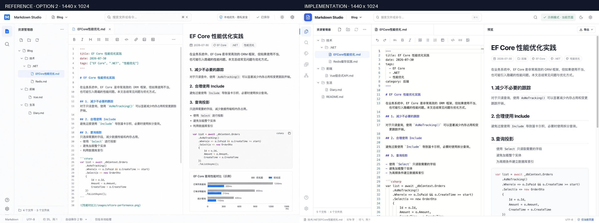
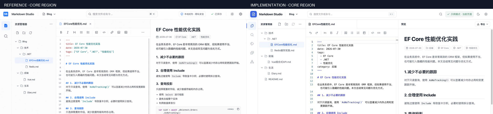

# Markdown Studio Design QA

## 验收基准

- 视觉方案：方案 2，Meowv Tools 浅色开发者工作台。
- 参考图：`.design/reference-option-2.png`，原始尺寸 1487 × 1058。
- 归一化参考图：`.design/reference-option-2-1440x1024.png`。
- 实现截图：`.design/implementation-1440x1024.png`，尺寸 1440 × 1024。
- 验收状态：`http://localhost:4004/?demo=1`，浅色主题，资源管理器打开，`技术/.NET/EFCore性能优化.md` 为当前文档。
- 同图对比输入：`.design/comparison-desktop.png`。
- 核心区域对比输入：`.design/comparison-core-region.png`。

## 桌面端对比

- 布局：顶部栏、活动栏、资源管理器、编辑器、预览和状态栏的层级、分隔线及三栏比例与参考图一致；没有重叠、裁切或错误换行。
- 间距与表面：侧栏行高、工具栏密度、细边框、轻阴影、选中态和内容留白保持同一视觉节奏。
- 字体：界面使用系统无衬线字体，编辑区使用等宽字体；调整预览标题上限后，标题层级与参考图接近且不挤压元数据。
- 颜色：主色使用 `#2563EB`，正文、弱化文本、边框、选中态和保存状态均映射到一致的浅色中性色阶。
- 图标：所有操作图标来自 Lucide；应用标记使用文档语义图标，未使用 Emoji、字符画、自制 SVG 或占位图。
- 内容：实现保留了参考图的 EF Core 示例，同时增加真实 Front Matter 分类、反向链接、资源图片和导出入口，以覆盖产品要求。
- 图像：预览中的性能对比图为真实 PNG 资源，比例、清晰度和边框处理正常。

## 核心区域复核

- 顶部栏搜索、工作空间选择、状态和设置控件均可用；当前示例模式明确显示只在当前页面处理。
- 文件树展开、文档选中、编辑器工具栏和预览标题在同一水平网格中，没有明显基线漂移。
- 实现比参考图多显示预览导出工具栏，这是 Phase 2 的必要操作入口，并保持了同样的密度和边框语言。

## 响应式与状态

- 编辑视图：`.design/implementation-mobile-390x844.png`。
- 预览视图：`.design/implementation-mobile-preview-390x844.png`。
- 文件侧栏：`.design/implementation-mobile-sidebar-390x844.png`。
- 打开文档后：`.design/implementation-mobile-after-open-390x844.png`。
- 390 × 844 下编辑与预览通过底部切换器互斥显示；文件侧栏作为覆盖层打开，并在选择文档后自动收起。
- 顶部操作、活动栏、状态栏和导出按钮没有碰撞；长标题、标签和正文均保持可读。

## 交互、可访问性与安全

- 已验证全文搜索、Wiki Link 跳转、知识图谱搜索、HTML 导出、移动端编辑/预览切换和移动端文件打开。
- 语义区域、按钮名称、搜索框标签、对话框焦点管理、键盘快捷键和可见焦点样式已实现。
- 远程 Markdown 图片和媒体被替换为本地提示；Mermaid SVG 在写入 DOM 前清洗，页面 CSP 进一步阻止渲染阶段的外部资源。
- 最终桌面状态浏览器控制台没有 warning 或 error。

## 修订记录

- 移除验收截图中的临时通知遮挡。
- 将桌面预览标题从最高 38 px 收敛到最高 34 px，贴近参考图比例。
- 修复移动端打开文档后侧栏未自动收起的状态。
- 保留必要的导出入口、分类标签与隐私状态，不以牺牲核心功能换取静态截图一致。

## 结论

- P0：0
- P1：0
- P2：0

final result: passed
